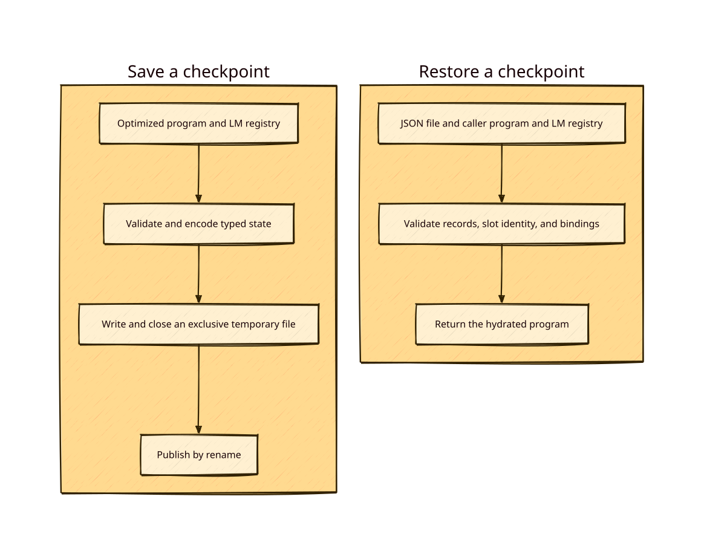

# Restore learned state into a caller-built program

## Context

Named predictor discovery and replacement already use typed paths. Composite BootstrapRS builds an ordered list of demos for each slot. `Predict` and `ChainOfThought` hold their signature, demos, generation config, and LM binding directly. The native checkpoint can use those capabilities without routing data through the flat Parameter codec, which stringifies map keys.

## Diagram

## Goals and scope

A caller-built program supplies the structure, field definitions, and runtime settings. The checkpoint supplies learned instructions, demos, generation config, and LM references. Public entry points are `Dspy.Module.save_state/3` and `Dspy.Module.load_state/3` with default options. The JSON and file handling belong in an internal program-state module.

## Decisions

### Format and slot identity

The envelope contains exactly `"format": "dspy_ex.program_state"`, `"version": 1`, and a `"slots"` array. Each record has `path`, `kind`, `inputs`, `outputs`, `instructions`, `demos`, `config`, and `lm`. The two kinds are `"predict"` and `"chain_of_thought"`. The field name arrays retain their signature order independently. Instructions are a UTF-8 string or null.

| Runtime position | JSON path segment |
| --- | --- |
| Struct field `:mapping` | `["field","mapping"]` |
| List or tuple position `0` | `["index",0]` |
| Map key `1` | `["key","integer",1]` |
| Map key `"1"` | `["key","string","1"]` |
| Map key `:"1"` | `["key","atom","1"]` |

A standalone predictor uses `[]`, including ChainOfThought. Reuse the actual paths from `Dspy.Module.PredictorSlots`. Display names include virtual pieces and are for callers reading the program. Match wire paths against paths encoded from the target, which supplies every path atom. Distinct entries may hold equal predictor values. A valid program may have an empty slot set.

### Portable demos and config

Each demo carries its `Dspy.Example` attributes and metadata. Encode a map as `{"entries":[[key,value],…]}`. Keys are `["string",text]` or `["atom",name]`. This preserves atom and string keys with the same spelling. Support these values recursively in attributes and metadata: null, booleans, numbers, UTF-8 strings, proper lists, and plain maps. Preserve null metadata when present. Attribute map atom keys must come from that predictor's signature fields. The only metadata atom key is the top-level `:inputs` used by `Example.input_keys/1`. Dataset split metadata and input selections written by `Example.with_inputs/2` already use string keys and values. Atom keys can be resolved through those small, explicit lookup tables. Other atom values, unsupported keys, structs, tuples, and executable terms are outside the v1 subset. Return an unsupported-value error for them on save.

Named BootstrapRS emits `Example.new/1` with preserved trace input keys and parsed output atom keys. It appends unchanged labeled training examples, which can carry input-selection metadata. The portable subset covers the traced Predict and ChainOfThought demos and labels in `test/teleprompt/bootstrap_rs_test.exs`. Runtime examples can still carry richer values such as conversation-history structs or extra atom fields used by application code.

Store the five supported `Dspy.PredictorConfig` keys as JSON object members. Decode through the fixed config vocabulary and validate through the existing config contract. Restore the stored map as a replacement, retaining `rollout_id: nil` as an explicit member and rejecting nulls for request fields that the existing normalizer would remove. `n` and token options remain positive integers. The target supplies field types, descriptions, defaults, and other schema details.

### LM registry

`lms:` maps nonempty UTF-8 names to valid bound LM values. Match a stored LM to an exactly equal registry value on save. A unique name is required for every bound slot. The name on disk resolves to the caller's value on load. Null restores an unbound predictor, which uses the configured LM at inference time. The state codec works with references and can validate registry values without inspecting or emitting their fields.

### Validation and publication

Decode JSON with string keys and retain object members until duplicate checks finish. Jason already supports `objects: :ordered_objects`. Reject duplicate typed slots and map entries before folding either into a map. Validate the full slot set and complete predictor payload. Use the discovered paths to apply the validated state with immutable replacement. The target owns fields that the state does not describe.

Encode successfully before opening a same-directory temporary file. Create the temporary file exclusively, close it after writing, and publish with a rename. Clean up a temporary file owned by this save when it fails. Exclusive creation prevents simultaneous saves from sharing a temp file. Each successful rename publishes a complete version of the file.

### Public errors

All errors are returned inside `{:error, reason}`. Locations use structural names and indices, and paths use the typed v1 representation. Error data excludes raw LM values and raw JSON input.

| Reason | Meaning |
| --- | --- |
| `:invalid_program` | The supplied value has no module traversal contract |
| `:invalid_state_options` | Options are malformed or contain unknown keys |
| `:invalid_lm_registry` | Registry keys or bound values are invalid |
| `:invalid_json` | File contents do not parse as JSON |
| `:unsupported_state_format` | The checkpoint has a foreign format identifier |
| `{:unsupported_state_version, integer}` | The native format has an unsupported integer version |
| `{:invalid_state, location}` | A record, object member, field, or tagged value is malformed |
| `{:unsupported_slot_key, location}` | A runtime predictor path uses a key outside the v1 subset |
| `{:unsupported_state_value, location}` | A runtime state value cannot be represented in v1 |
| `{:duplicate_slot, path}` | The same typed predictor slot occurs twice |
| `{:duplicate_demo_key, location}` | The same exact key occurs twice in one demo map |
| `{:slot_set_mismatch, %{missing: paths, extra: paths}}` | File and target identify different slot sets |
| `{:predictor_kind_mismatch, path}` | The kind at a matching slot differs |
| `{:signature_mismatch, path}` | Ordered input or output field names differ |
| `{:missing_lm_reference, path}` | Save found no registry name for a bound LM |
| `{:ambiguous_lm_reference, path}` | Save found multiple names for a bound LM |
| `{:unknown_lm_reference, path}` | Load could not resolve the saved LM name |
| `{:file_error, operation, reason}` | Read, write, or rename failed |

## Risks and trade-offs

- Custom demos may contain runtime objects or application-specific atom keys. Explicit v1 coverage and errors give the caller a verifiable boundary.
- Matching names and kinds cannot verify arbitrary caller code. The same field schema, program logic, and runtime setup are prerequisites for the inference equivalence check.
- Replace-by-rename addresses partial writes and concurrent publication. The checkpoint is a local file format with ordinary filesystem durability.
